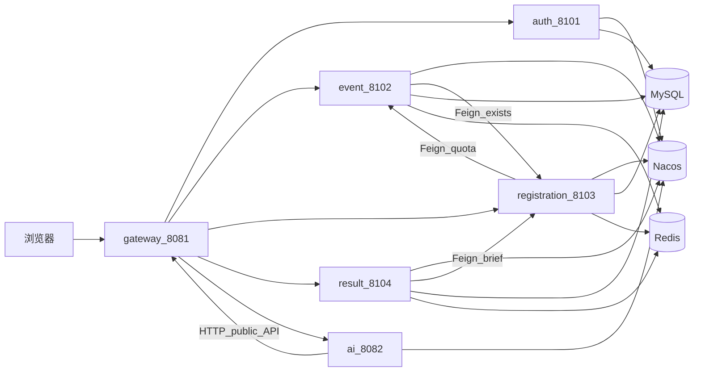

# 发令台 GUNSTART：从业务闭环到 Spring Cloud Alibaba 领域微服务

> 副标题：Java 8 / Boot 2.7 稳住赛事核心，Nacos + Gateway + Feign 按领域拆分，Spring AI 旁路增强  
> 标签：`Spring Cloud Alibaba` `Nacos` `Gateway` `OpenFeign` `MyBatis` `Redis` `JWT` `Spring AI` `毕设实践`

> **摘要**：马拉松报名不是一张 CRUD 表。本文以「发令台 GUNSTART」为例，讲述如何先用单体跑通报名—支付—退赛—成绩全链路，再按领域拆成可答辩的微服务：Gateway 统一入口与鉴权，业务服务用 Feign 协作，AI 用 Boot 3 旁路挂上同一 Nacos。文中对账仓库现状（端口、模块、路由、取舍），适合作为毕设复盘与同类系统的演进参考。

---

## 写在前面

做赛事类系统时，最容易掉进两个坑：

1. **只做后台表格**：页面像管理台，没有「跑者报名 → 支付 → 赛后查成绩」的完整叙事。  
2. **概念堆满**：微服务、网关、真实支付、消息队列一齐上，演示时环境崩、链路断、讲不清。

发令台走的是另一条路：**业务闭环优先，外部能力可插拔，新技术旁路接入，微服务按领域拆、不按 PPT 拆**。

仓库名 `marathon_system`。当前形态：

| 角色 | 地址 | 说明 |
|------|------|------|
| 跑者公开平台 | `http://localhost:8081/` | 赛事、报名、OTP、排名、赛事助手 |
| 组委会管理台 | `http://localhost:8081/admin.html` | 赛事 / 选手 / 成绩 / 导出 |
| 统一入口 | Gateway `:8081` | 静态页 + JWT + 按路径转发 |
| AI | Gateway `/api/ai/**`（或直连 `:8082`） | Spring AI 赛事问答 |

演示账号：`admin` / `123456`。启动清单见同目录 [`微服务启动说明.md`](./微服务启动说明.md)。

---

## 一、要解决什么问题

真实报名链路至少有这些硬约束：

1. **名额与防重**：同人同赛不可重复；满额必须挡掉。  
2. **支付与状态机**：未支付 / 已支付 / 取消 / 退款窗口，每一步要可解释、可审计。  
3. **赛后资产**：成绩、分段、公开排名——读多写少，适合缓存。  
4. **双端体验**：跑者要轻（手机号 OTP 即可）；组委会要批量与 Excel。  
5. **演示可信**：支付、短信往往接不到真实商户，但不能假装「系统里没这块」。

收敛成一句话：

> 用可讲清的领域服务托住完整业务叙事；支付 / 短信走可审计 mock；AI 旁路增强体验，但不绑架业务服务的 Java / Boot 版本。

---

## 二、技术栈与总体架构

### 2.1 版本清单

| 组件 | 版本 / 约定 | 说明 |
|------|-------------|------|
| 业务服务 | Java 8 · Spring Boot **2.7.14** | 端口见下表 |
| 微服务全家桶 | Spring Cloud **2021.0.8** · SCA **2021.0.5.0** | 与 Boot 2.7 匹配 |
| 注册中心 | Nacos 2.x · `localhost:8848` | 服务发现 |
| 网关 | Spring Cloud Gateway | **8081**，对外唯一入口 |
| 调用 | OpenFeign + LoadBalancer | 跨服务写路径 / 校验 |
| 持久化 | MyBatis 2.3.1 · MySQL 8 | 库名 `marathon_system` |
| 缓存 | Redis（Lettuce + 连接池） | OTP、分页 / 排名缓存 |
| 鉴权 | JJWT 0.11.5 | Gateway 全局校验；auth 签发 |
| 文档 | Knife4j 4.4（OpenAPI2） | 各业务服务可单独开 |
| 导出 | Apache POI 5.2.5 | 报名花名册 / 成绩榜 |
| 前端 | 原生 HTML/JS，无构建 | Gateway 静态托管 |
| AI 旁路 | Java 21 · Boot **3.4.5** · Spring AI **1.0.9** | 端口 **8082**，亦注册 Nacos |

### 2.2 进程与职责

| 进程 | 端口 | 职责 |
|------|------|------|
| Nacos | 8848 | 注册发现 |
| `marathon-gateway` | **8081** | 路由、JWT、静态页 |
| `marathon-auth` | 8101 | 管理员登录，签发 JWT |
| `marathon-event` | 8102 | 赛事 CRUD、封面、公开赛事列表 / 详情 |
| `marathon-registration` | 8103 | 选手、报名、OTP、模拟支付、退赛退款 |
| `marathon-result` | 8104 | 成绩、排名、统计、导出 |
| `marathon-ai-service` | 8082 | 赛事助手（Tool Calling） |

Maven 结构：

```text
marathon-parent
├── marathon-common      # Result / PageResult / JWT / Redis 工具
├── marathon-api         # Feign 接口 + 跨服务 DTO
├── marathon-gateway
├── marathon-auth
├── marathon-event
├── marathon-registration
├── marathon-result
└── ai-service           # 独立工程（Boot 3），不绑父工程 Java 8
```

根目录 `src/` 保留改造前**单体备份**，父 POM `packaging=pom`，不再打包该目录。

### 2.3 请求怎么走



设计要点：

- **对外路径尽量不变**：前端仍调 `/api/public/**`、`/api/event/**` 等相对路径，由 Gateway 按更具体的 Predicate 转发。  
- **服务间写协作走 Feign**：名额增减、删赛事前校验、成绩录入前校验报名。  
- **AI 不进业务 jar**：Tool 调 Gateway 公开赛事 API，事实以业务库为准。

---

## 三、为什么这样拆，而不是一上来微服务

### 3.1 先闭环，再拆分

早期单体把报名、支付 mock、OTP、成绩、管理台全部跑通，证明：

- 状态机能讲清；  
- 支付 / 短信可插拔；  
- 前端双端可用。

拆分时边界已经清晰，避免「服务拆了，事务语义却讲不清」。

### 3.2 按领域拆，不按技术层拆

| 服务 | 表归属（逻辑） | 对外能力 |
|------|----------------|----------|
| auth | `admin` | `POST /api/login` |
| event | `marathon_event` + 上传目录 | 管理赛事、公开列表 / 详情、名额字段写入 |
| registration | `runner` / `registration` / `payment_log` / `sms_log` / 通知 | 报名支付 OTP、管理选手报名 |
| result | `result` | 录入、排名、统计、导出 |
| ai | 无业务表 | 问答 + Tool |

**共享 MySQL 一库**：毕设演示优先稳定。约定是「表有主人、禁止跨服务注入对方 Mapper」；公开榜等复杂只读 SQL 允许在归属服务内做 JOIN（同一库），写路径必须 Feign。

**不做**（刻意控制范围）：Seata 分布式事务、Sentinel / RocketMQ 全家桶、真正的 DB-per-service。答辩时可以说清「为什么没上」，比硬上更有说服力。

### 3.3 AI 旁路：版本隔离

业务锁在 Boot 2.7 / Java 8 时，硬升 Spring AI 成本极高。`ai-service` 单独 Boot 3 + Java 21，注册同一 Nacos，Gateway `lb://marathon-ai-service`。这是「核心稳定」与「能力尝鲜」并行的一刀。

---

## 四、网关：统一入口与 JWT

### 4.1 路由（具体路径优先）

| Predicate（示意） | 目标 |
|-------------------|------|
| `/api/login` | auth |
| `/api/public/event/*/stats`、`/api/public/rank/**` | result |
| `/api/public/events/**`、`/api/public/event/**` | event |
| `/api/public/signup`、`confirmPay`、`otp/**`、`cancel`、`notices`、`my` | registration |
| `/api/event/**`、`/uploads/**` | event |
| `/api/runner/**`、`/api/register/**` | registration |
| `/api/result/**`、`/api/statistics/**` | result |
| `/api/ai/**` | ai-service |
| `/`、`/admin.html`、`/assets/**` | Gateway 静态资源 |

`order` 越小越优先，避免 `/api/public/event/**` 抢掉 `.../stats`。

### 4.2 鉴权策略

- **管理端**：登录拿 JWT → 请求头 `Authorization: Bearer ...` → Gateway `GlobalFilter` 校验。  
- **白名单**：`/api/login`、`/api/public/**`、`/api/ai/**`、静态资源、文档相关路径。  
- **业务服务**：去掉进程内 Shiro 过滤器链，避免与网关双重打架；密钥仍共用 `jwt.secret`。

跑者端不走管理员 JWT，而是 **手机号 OTP + Redis**（`public:otp:*` / `public:runner:*`），凭证头 `X-Runner-Token`，由 registration 服务持有会话语义。

演示环境管理员密码仍为明文比对——**答辩可讲不足，生产必须 BCrypt，且 secret 出仓库**。

---

## 五、核心业务怎么在微服务里落地

### 5.1 报名与名额（registration ↔ event）

单体时代：同一事务里插 `registration` 并 `registered_count++`。  
拆分后：

1. registration Feign 拉赛事摘要（状态、名额、费用）；  
2. 本地校验防重、写报名与支付日志 / 通知；  
3. Feign 调 event：`increase` / `decrease` / `sync(activeCount)`。

失败时用「占名额 → 本地写 → 失败则回滚名额」的补偿叙事；答辩可讲**最终一致性**，而不是假装还有全局事务。

### 5.2 支付与退赛（registration）

- 收银台：`pay.gateway=mock`，写 `payment_log`，凭证可追踪。  
- 退赛：比赛日前 N 天窗口；已支付走退款单号原路退回（mock）；未支付只释放名额。  
- 短信：`sms.provider=local` 落 `sms_log`，`expose-code=true` 方便答辩展示验证码。

### 5.3 成绩与排名（result）

- 录入前 Feign 取报名摘要，确认报名存在且有效。  
- 公开排名 / 完赛统计：复杂窗口函数与 JOIN 放在 result 侧（共享库只读），对外路径仍是 `/api/public/rank/{eventId}`、`/api/public/event/{id}/stats`。  
- 排名列表可走 Redis 前缀缓存，写入成绩后失效。

### 5.4 管理端能力

赛事封面上传、选手档案、号码布、Excel 导出、赛事总览统计——路径前缀保持，前端改动面可控。

---

## 六、赛事助手（AI 旁路）

能力：自然语言问「有哪些可报名赛事、还剩多少名额」等。

实现要点：

1. Spring AI `ChatClient` + 结构化输出（卡片列表 + `grounded` 标记）。  
2. `@Tool` 经 HTTP 调 Gateway 的 `/api/public/events` 等，**不靠模型背库存**。  
3. 注册 Nacos；前端 `api.js` 默认同源空 `aiBase`，即走 `http://localhost:8081/api/ai/chat`。

默认模型走 OpenAI 兼容协议（如 DeepSeek）；密钥放 `ai-service/application-local.yml`，已 gitignore。

---

## 七、工程化与答辩友好点

1. **配置分层**：公共 `application.yml` 可提交；密码与本机路径进 `application-local.yml`。  
2. **统一响应**：`Result` / `PageResult` 在 `marathon-common`，前后端契约稳定。  
3. **Feign 契约**：`marathon-api` 集中 DTO 与 Client，避免各服务私自复制字段。  
4. **静态免 CORS**：页面与 API 同属 8081。  
5. **文档**：[`微服务启动说明.md`](./微服务启动说明.md)、[`答辩环境配置说明.md`](./答辩环境配置说明.md)。

本地最小依赖：Nacos + MySQL + Redis +（可选）AI Key。

---

## 八、刻意的不足（写进答辩更好）

| 点 | 现状 | 演进方向 |
|----|------|----------|
| 管理员密码 | 明文 | BCrypt / Argon2 |
| JWT secret | 配置文件示例值 | 环境变量 / 配置中心加密 |
| 数据边界 | 一库多服务 | 读模型拆分或真正分库 |
| 名额一致性 | Feign + 补偿 | 若上生产再评估锁 / 流水表 |
| 可观测性 | 日志为主 | 链路追踪、统一审计 |
| 中间件广度 | 未堆 Sentinel/MQ | 有真实流量痛点再加 |

把「没做」说清楚，比假装「全家桶都上了」更像工程。

---

## 九、小结

发令台证明的一件事：

> **先把赛事叙事跑通，再按领域拆服务；网关守入口，Feign 守写协作，AI 守体验但不守版本。**

如果你在做同类毕设，可复用的顺序是：

1. 单体闭环（报名状态机 + mock 支付短信 + 双端）；  
2. 抽出 common / api，上 Nacos + Gateway，路径兼容前端；  
3. 按 event / registration / result / auth 迁代码，写路径改 Feign；  
4. AI 旁路 Boot 3，注册同一注册中心。

仓库入口与启动以 README、`docs/微服务启动说明.md` 为准。欢迎按自己的赛场规则改表结构与状态机——架构可以抄，业务约束请自己想清楚。
